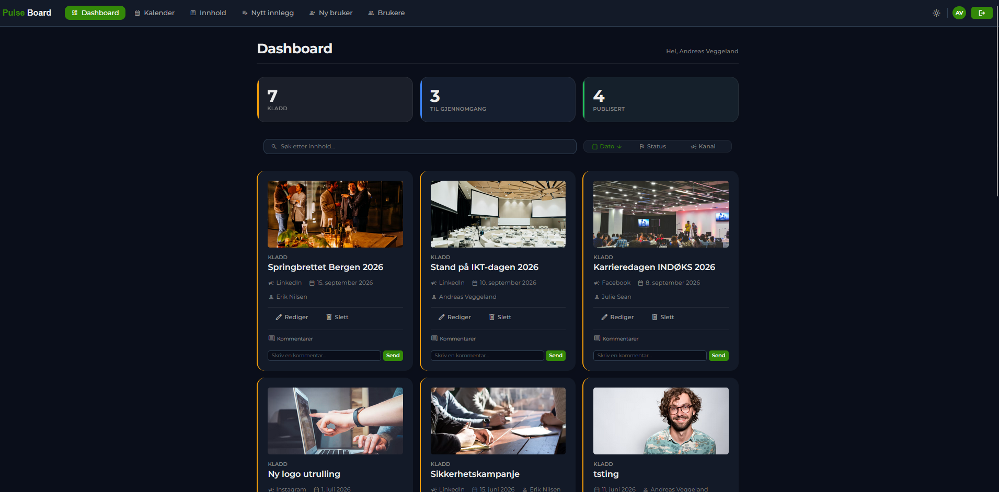
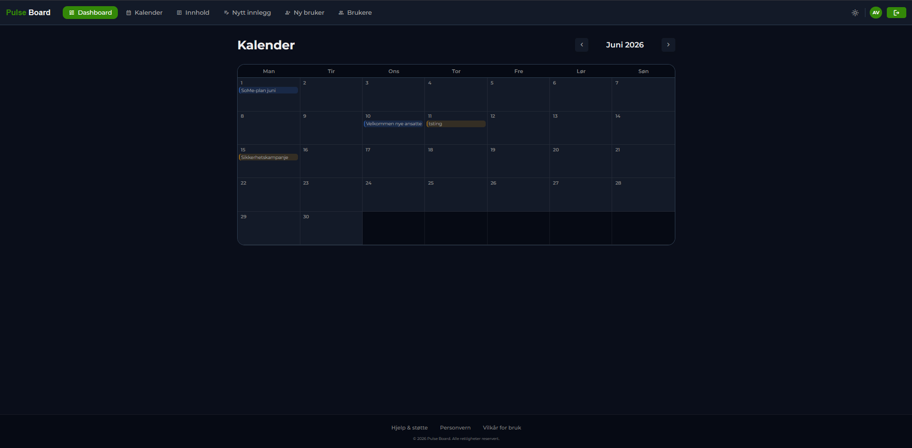
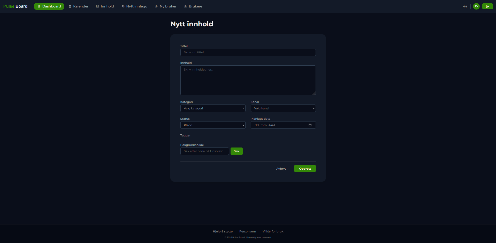
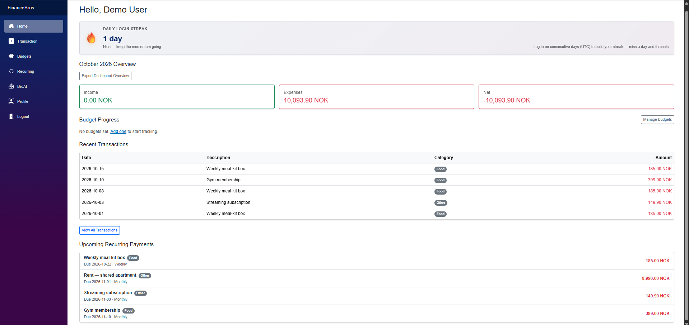
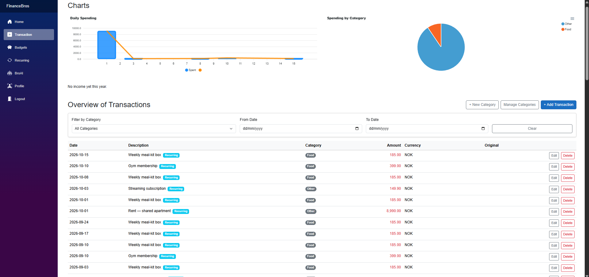
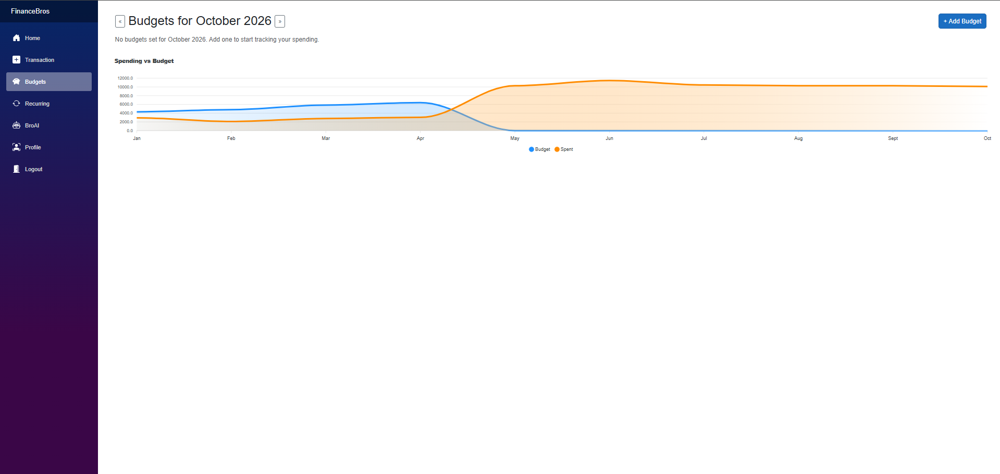
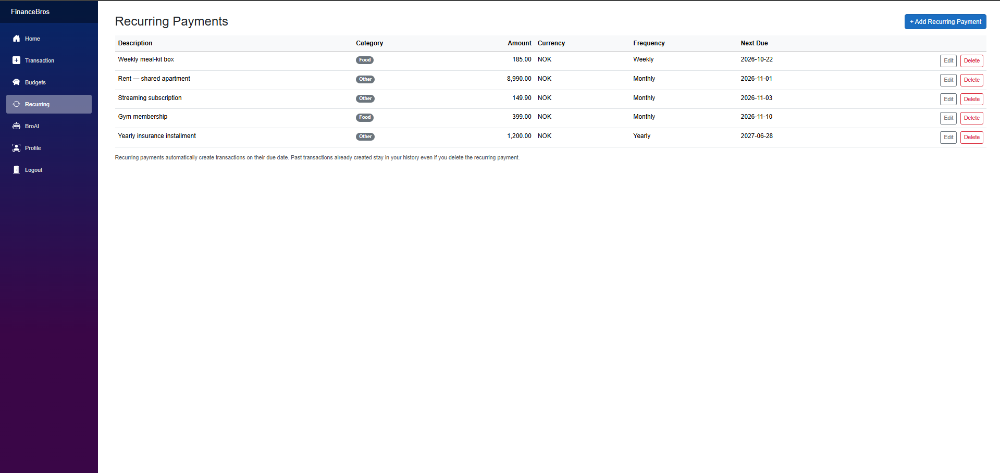
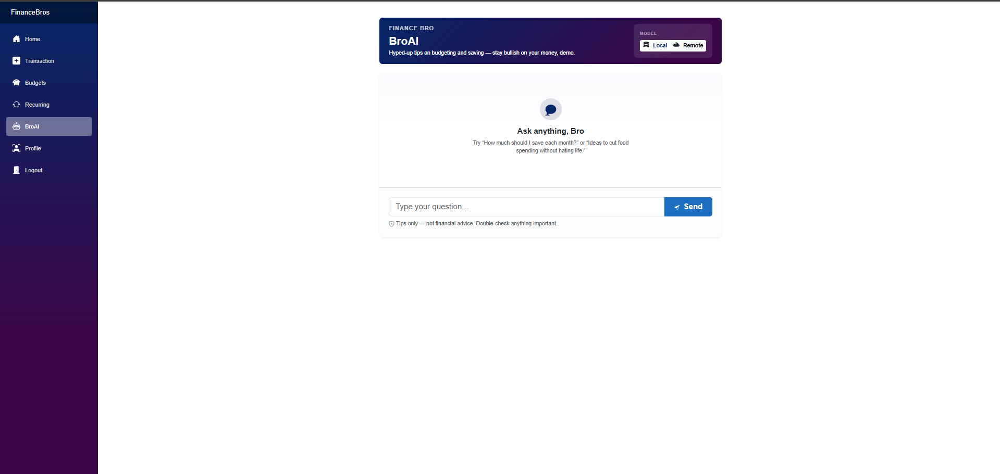
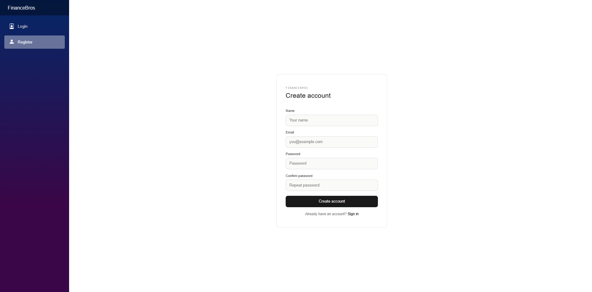

# Hey, I'm Sean! 👋

I'm currently studying Computer Engineering (Datateknologi) at the University of Stavanger (UiS), Norway.

I mostly use GitHub for my university projects and other things I'm working on.

## Technologies I've worked with

- **Languages:** Python, C#, SQL
- **Backend & web:** Flask, ASP.NET Core, Blazor, REST APIs, Entity Framework Core
- **Databases:** MySQL, SQLite
- **Networking:** Cisco Packet Tracer, IPv4/IPv6, subnetting, VLANs, routing, switching, DHCP, and troubleshooting

## University Projects

### PulseBoard (Databaser og webprogrammering)

A university group project where we built a web application for planning and managing communication content.

The application includes a calendar, dashboard, content management, user authentication, and role-based access control.

I mainly worked on the backend using **Python, Flask, and MySQL**, while my teammate focused on the frontend. We worked together to connect both parts of the application.

We used Lyse as a case study, but this was not an official collaboration with Lyse. The source code is kept private.

**Dashboard**

More screenshots

**Calendar**

**Creating Content**

### FinanceBros (Programvareutvikling)

A financial management application we built as a university group project using **C#, ASP.NET Core, Blazor, and SQLite**.

The application includes budgeting, transaction management, recurring payments, and user accounts.

My main contributions were:
- Authentication and authorization
- Password recovery through email
- Discord login integration
- Admin panel security checks

**Home**

More screenshots

**Transactions**

**Budgets**

**Recurring Payments**

**BroAI**

**Registration**

### Networking Labs (Kommunikasjonsteknologi 1)

As part of DAT230 at UiS, I completed weekly networking labs covering:

- **IP networking:** IPv4, IPv6, subnetting, and VLSM
- **Switching:** VLANs, trunking, and inter-VLAN routing
- **Routing and services:** Router configuration, DHCP, NAT, and HSRP
- **Troubleshooting:** `ping`, `traceroute`, and Cisco `show` commands
- **Other tools:** Cisco Packet Tracer, Wireshark, Mininet, and iperf3

The labs gave me practical experience with network configuration, connectivity testing, and basic troubleshooting.
